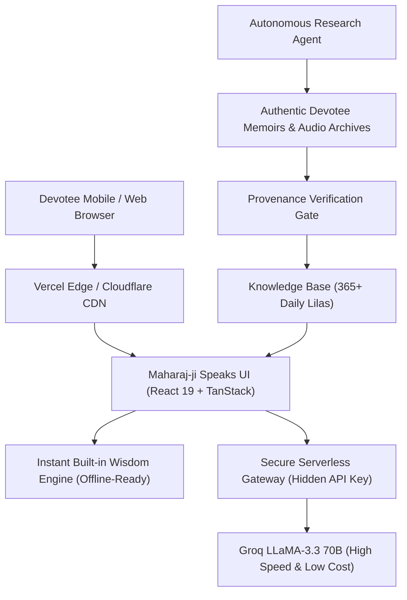

# 🌸 Maharaj-ji Speaks: Proposal for Growth, Wisdom & Transformation
*A Comprehensive Roadmap to Make the Platform Robust, Secure, Culturally Authentic, and Deeply Comforting for Devotees Worldwide*

---

## 📌 1. Purpose & Vision

The platform [maharaja-ji.com](https://maharaja-ji.com/) is far more than a typical AI application; it is a **digital sanctuary** for seekers and devotees in the sacred spirit of **Neem Karoli Baba (Maharaj-ji)**. In times of anxiety, loneliness, or spiritual searching, visitors come seeking fatherly warmth, solace, and timeless wisdom (*Sub Ek — Love Everyone, Serve Everyone, Remember God*).

This document outlines an actionable, plain-English roadmap incorporating the latest innovations, user-pitched concepts, and architectural enhancements to make the platform:
1. **Autonomous & Ever-Expanding in Wisdom** (via an authentic AI Research Agent)
2. **Deeply Interactive & Devotional** (Voice-activated Japa Mala, full audio controls, and daily morning prasad)
3. **100% Free, Secure & Lightning Fast** (Zero API keys needed by users, edge caching, and cost-effective backend)
4. **Culturally & Linguistically Native** (Natural Hindi/Hinglish understanding and Devanagari voice synthesis)

---

## 🌟 2. Key Features & New Proposals

### A. 🧠 Autonomous Spiritual Research Agent ("Lila & Vani Seeker") *(User-Pitched Idea)*
* **The Opportunity:** Maharaj-ji never wrote books or delivered formal public sermons; his teachings live in personal memoirs, ashram diaries, and oral testimonies recorded by devotees across India and the West. A static database runs out of stories quickly.
* **How the Research Agent Works:**
  1. **Curated Historical Indexing:** The agent searches and parses verified, authentic devotee literature, including:
     - *Miracle of Love: Stories of Neem Karoli Baba* (Compiled by Ram Dass)
     - *By His Grace* and *The Near and the Dear* (Dada Mukerjee)
     - *Love Everyone* (Parvati Markus)
     - *Premavatar* (Ram Narayan Sinha)
     - Kainchi Dham and Vrindavan Ashram historical bulletins
     - Love Serve Remember Foundation audio transcripts (Ram Dass, Krishna Das, Larry Brilliant, K.K. Sah)
  2. **Strict Provenance Gate (Zero Hallucinations):** The agent never fabricates miracles. Every story must pass a 4-point verification check:
     - **Devotee Name:** Who experienced or recorded the event?
     - **Location:** (e.g., Kainchi Dham, Vrindavan, Bhumiadhar, Allahabad, Hanumangarh)
     - **Time Period:** (approximate decade/year between 1930s–1973)
     - **Core Virtue:** (e.g., Faith, Forgiveness, Feeding the Hungry, Healing, Overcoming Grief)
  3. **Automated Knowledge Enrichment:** The agent formats verified findings into clean, categorized entries that automatically expand the `knowledgeBase.ts` and ensure a unique, authentic story for all 365 days of the year.

---

### B. 📿 Voice-Activated Hands-Free Japa Mala Counter *(User-Pitched Idea)*
* **What It Does:** Devotees chanting holy names (*"Ram Ram"*, *"Sita Ram"*, *"Om"*, *"Hare Krishna"*, *"Hanuman"*) can chant aloud naturally without looking at or tapping their screen. The app uses the microphone to detect each sacred utterance and automatically increments the 108 bead counter.
* **Safeguards & Robust Fallbacks:**
  - **Speech Boundary Whitelist:** Rejects casual background chatter, music, or conversation; only recognized mantra patterns trigger bead counts.
  - **Rhythmic Cooldown Guard (320ms Debounce):** Prevents microphone echo or prolonged syllables from triggering accidental double counts.
  - **Auto-Reconnection on Silence:** Chrome/Edge speech recognition often stops after pauses; the engine smoothly restarts without losing devotee count.
  - **Sacred 528Hz Solfeggio Temple Bell:** Upon completing 108 beads (1 full mala), a soothing temple bell chime rings, accompanied by gentle phone vibration haptics.

---

### C. 🇮🇳 Native Hindi & Hinglish Auto-Detection
* **The Problem:** Many devotees speak or type colloquial Hindi using Roman script (e.g., *"Mein kya kar sakta hoon"*, *"Baba kripa karo"*, *"Mujhe shanti chahiye"*). If the AI responds in English, the emotional connection and spiritual comfort are lost.
* **The Solution:**
  - Automatic language and script detection identifies Devanagari Hindi or conversational Romanized Hinglish.
  - Maharaj-ji immediately replies in warm, loving, fatherly Hindi (*"बेटा, कुछ बड़ा करने की चिंता मत करो..."*).
  - Web Speech synthesis uses the `hi-IN` Indian voice with natural inflection and pacing.

---

### D. 🔊 Full Audio Playback Suite (Listen, Pause, Resume, Restart)
* **What It Does:** Replaces the basic one-click audio trigger with a full playback controller:
  - **Pause:** Pause Maharaj-ji's words at any moment to reflect.
  - **Resume:** Continue seamlessly from where it paused.
  - **Stop:** Immediately silence audio without reloading.
  - **Restart:** Replay the blessing from the very beginning.
  - Works consistently across both chat blessings and Daily Prasad readings.

---

### E. 🌸 Single Daily Prasad & Social Blessing Sharing
* **What It Does:** Instead of an endless shuffle button, the app provides a **single, sacred Daily Prasad** synchronized with the calendar day.
* **Devotee Sharing:** A one-click **"Share Prasad"** button lets devotees send the daily teaching or miracle story directly to family on WhatsApp, SMS, or social media with one tap.

---

### F. 🕊️ Community Lila Contribution & Verification Portal *(Future Scope)*
* **What It Does:** Many elderly families in Kumaon, Uttarakhand, and Uttar Pradesh have precious firsthand stories of Maharaj-ji told to them by their parents that have never been written in books.
* **The Solution:** A simple community submission form where devotees can share family accounts. Submissions are checked by the Research Agent against historical timelines and ashram travel logs, allowing verified community treasures to be preserved for future generations.

---

## 🛠️ 3. Security, Cost & Architecture Upgrades

### 1. Zero Secret Exposure
- Move all AI completions behind a secure, serverless API route (`/api/chat`).
- Remove any requirement for devotees to supply or see an API key.

### 2. Token & Cost Optimization
- Restructure system prompts to be succinct (150 words) rather than sending thousands of lines of context on every trivial query.
- Use ultra-fast, cost-effective inference (Groq / Cloudflare Workers AI) keeping monthly operational costs near $0.

### 3. Elder-Friendly Accessibility
- Bada Akshar toggle (large fonts, clear contrast, large click targets).
- Full keyboard and screen-reader accessibility for visually impaired devotees.

---

## 📅 4. Implementation Phasing

| Phase | Focus Areas | Deliverables |
| :--- | :--- | :--- |
| **Phase 1: UI Polish & Core Experience** *(Completed)* | Visuals & Layout | Saffron aura background, aligned suggestion cards, single daily prasad, share button, and audio playback controls (Pause/Stop/Restart). |
| **Phase 2: Voice & Language Intelligence** *(Completed)* | Voice & Multilingual | Speech-activated Japa Mala with mantra regex fallbacks, Hindi/Hinglish intent matcher, and Hindi voice synthesis. |
| **Phase 3: Autonomous Research Agent** | Knowledge Expansion | Build autonomous research workflow to ingest out-of-print memoirs (*Miracle of Love*, Dada Mukerjee books) with provenance checks. |
| **Phase 4: Backend Security & Deploy** | Infrastructure | Deploy serverless proxy on Vercel/Cloudflare, connect production custom domain, and launch mobile PWA for offline use. |

---

## 🕉️ 5. Conclusion

By merging **cutting-edge agentic research** and **voice technology** with **deep reverence for Maharaj-ji's message of love, service, and devotion**, this platform stands out as a unique, respectful, and comforting digital sanctuary. It honors the oral tradition of Kainchi Dham while leveraging modern AI to keep Baba's presence alive in the hearts of devotees everywhere.
